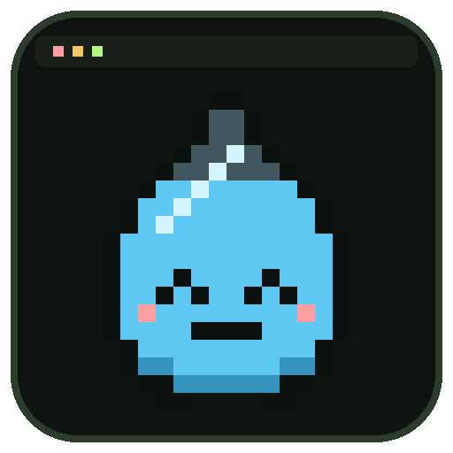
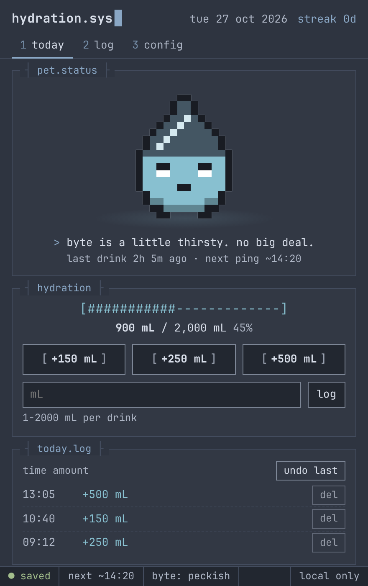
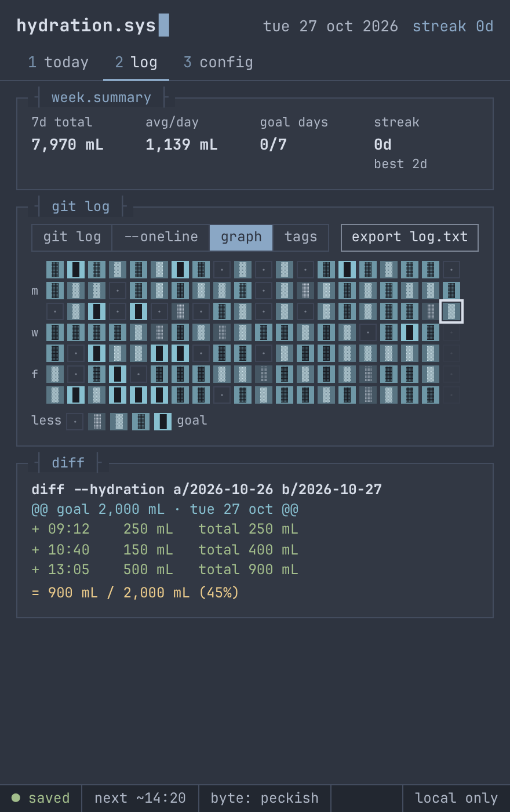
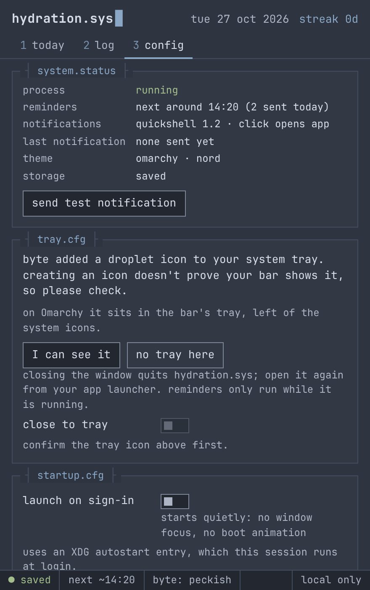
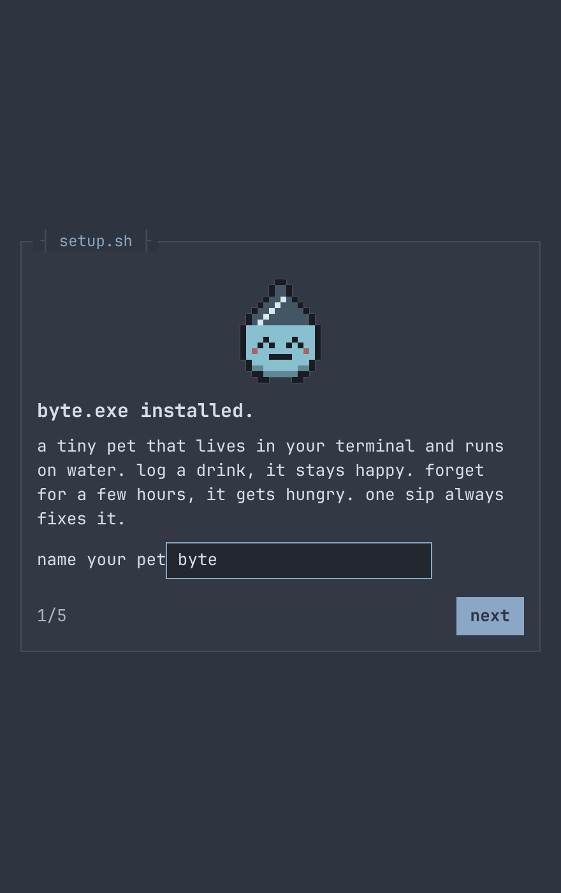
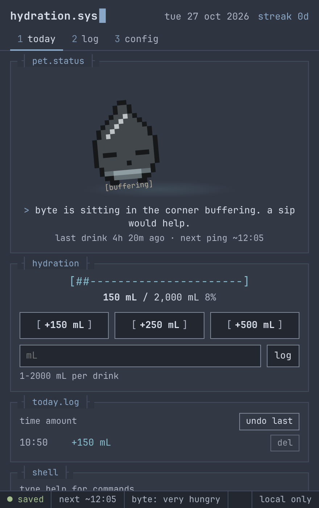
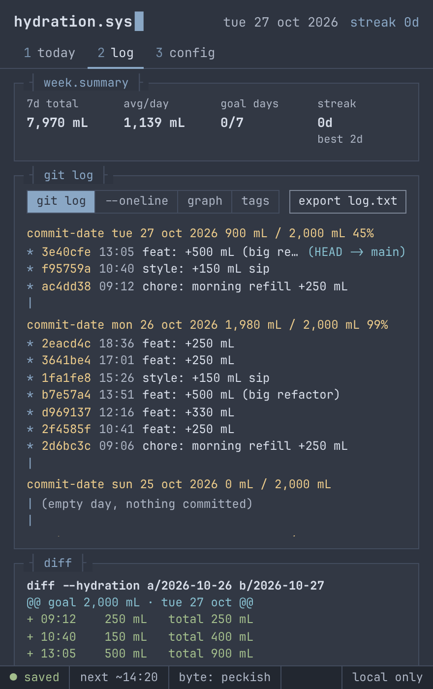

<p align="center">
  
</p>

<h1 align="center">hydration.sys</h1>

<p align="center">
  <b>A tiny terminal pet that runs on water.</b><br>
  Byte lives in your tray, nudges you to drink during your active hours,<br>
  gets hungry when you forget, and keeps a git-style log of every sip.
</p>

<p align="center">
  <code>linux · omarchy (hyprland + quickshell)</code>&nbsp;
  <code>windows</code>&nbsp;
  <code>local only · no account · no network</code>
</p>

<p align="center">
  
  
  
</p>

<p align="center"><sub>shown with the Omarchy Nord theme. Byte recolors itself to whatever theme you run.</sub></p>

## What it does

- **Byte** gets peckish, hungry and very hungry (slumped in the corner,
  buffering) the longer you go without a drink *inside active hours*. One drink
  always fixes it. It never dies, never guilts, never progresses overnight.
- **Reminders** come from the native process (not the webview), at most one at
  a time (each replaces the last), with a minimum gap, a daily max, snooze,
  pause-for-today, quiet hours, and a full stop once the goal is reached. After
  sleep or a long shutdown you get one reminder, never a burst.
- **Tray**: log 150/250/500 mL, Byte's mood, today's progress, snooze, pause,
  settings, quit. The icon changes with Byte's mood.
- **History**: `git log --graph`-style commits with deterministic hashes, a
  `--oneline` view, a 20-week contribution heatmap (glyphs as well as color,
  keyboard navigable), cosmetic tags (`v1.0`, `streak-3/7/30`, `merge`), a
  per-day diff view, weekly summary and a `log.txt` export.
- **Command bar**: `drink 250`, `drink 8oz`, `status`, `log [--oneline]`,
  `streak`, `hydration log|status`, `help`. A fixed whitelist; nothing is ever
  evaluated or executed.
- **Themes**: follows the active Omarchy theme live (`omarchy theme set` and
  Byte recolors), or phosphor green / amber. Chill mode and no-jokes mode for
  quieter copy; reduced motion removes blinking, glitching and the boot screen.

The daily goal (2,000 mL by default) is only an example. Needs vary; this is
not medical advice, and Byte is not a health indicator.

<table align="center">
  <tr>
    <td align="center"><br><sub>first run: name your pet</sub></td>
    <td align="center"><br><sub>four hours without water</sub></td>
    <td align="center"><br><sub><code>git log</code> for your water</sub></td>
  </tr>
</table>

## Install on Omarchy / Arch (user-local, no sudo)

Prerequisites (from the official Tauri v2 prerequisites page, Arch section):

```sh
sudo pacman -Syu
sudo pacman -S --needed webkit2gtk-4.1 base-devel curl wget file openssl \
  appmenu-gtk-module libappindicator-gtk3 librsvg xdotool
```

plus Rust (`rustup`, stable) and Node 20+. Then:

```sh
scripts/install-linux.sh          # builds if needed, installs to ~/.local
```

This installs `~/.local/bin/hydration-sys`, a launcher
(`~/.local/share/applications/hydration-sys.desktop`) and icons. Open it from
the Omarchy app launcher like any other app.

Recommended Hyprland rule (keeps it a small floating window instead of a tiled
pane), in `~/.config/hypr/hyprland.lua`:

```lua
o.window("^(hydration-sys)$", { float = true, center = true, size = { 440, 700 } })
```

The Omarchy bar keeps tray icons in a drawer (the `<` arrow). To keep Byte
always visible, hover the drawer and pin it, or add
`"pinned": ["tray-icon tray app main"]` to the `omarchy.tray` entry in
`~/.config/omarchy/shell.json`.

## Windows

Prerequisites (official Tauri v2 docs): Microsoft C++ Build Tools with
"Desktop development with C++", WebView2 (already on Windows 10 1803+ and 11),
Rust with the MSVC toolchain (`rustup default stable-msvc`), Node 20+. Then:

```powershell
npm ci
npx tauri build --bundles nsis      # per-user installer, no admin needed
```

The installer lands in `src-tauri\target\release\bundle\nsis\`. Builds are
unsigned, so SmartScreen may warn ("More info" > "Run anyway"). Windows shows
the proper app name and icon on notifications only for the installed app, not
`tauri dev`. The tray icon may sit in the overflow area (the `^` next to the
clock); drag it onto the taskbar to keep it visible.

**Not tested on Windows yet** (built and tested on Arch/Omarchy only). See the
checklist at the end.

## Develop

```sh
npm ci
npx tauri dev                 # real app with hot reload
npm run dev:mock              # UI only in a browser, with a fake backend:
                              #   http://localhost:1420/?scenario=today|hungry|veryHungry|goal|history|fresh
npm test                      # TypeScript unit tests (vitest)
npm run test:rust             # Rust unit tests (cargo test)
npx playwright test           # headless UI tests against the mock
scripts/guarded-test.sh       # the real binary in Xvfb + private D-Bus with a
                              # mock notification server and tray watcher
npx tauri build --no-bundle   # release binary only
npx tauri build --bundles deb rpm appimage
npm run icons                 # app/tray icons + docs/icon.svg from the sprite grid
node scripts/readme-shots.mjs # README screenshots (docs/screens)
```

Useful environment variables (all builds):

- `HYDRATION_SYS_DATA_DIR=/abs/path`: store data there instead of the app data dir.
- `HYDRATION_SYS_CLOCK_OFFSET_MIN=-480`: shift the app's clock (testing hunger,
  reminders, day rollover). Settings shows a warning while it's active.

## How the background parts work

| | Linux (Omarchy) | Windows |
|---|---|---|
| Reminders | native scheduler thread, wakes at the next due time (capped at 60 s so sleep/resume, clock changes and midnight are noticed) | same |
| Notifications | `org.freedesktop.Notifications` on the session bus (Quickshell on Omarchy). Respects DND. Clicking opens the app; a "log 250 mL" button is offered when the server advertises actions | Tauri notification plugin (toasts). No click or button actions; use the tray |
| Tray | StatusNotifierItem via libayatana-appindicator; Quickshell shows it. Menu only (clicks on the icon itself aren't forwarded by most Linux hosts) | system tray; left click toggles the window, right click opens the menu |
| Launch on sign-in | Tauri autostart plugin writes `~/.config/autostart/hydration.sys.desktop`. Omarchy runs these through systemd/uwsm (`xdg-desktop-autostart.target`); settings checks that and otherwise shows a Hyprland line to add instead | Tauri autostart plugin (startup registry entry) |
| Closing the window | hides to the tray only after you confirm you can see the tray icon; otherwise closing quits | same |
| Second launch | single-instance plugin: focuses the existing window; a duplicate login launch does nothing | same |

Reminders only work while the app runs. Quit (tray or settings) ends the
process; nothing runs after quit, logout or shutdown.

Manual alternative to the switch (Hyprland Lua config, Omarchy 4+), in
`~/.config/hypr/autostart.lua`: `o.launch_on_start("$HOME/.local/bin/hydration-sys --autostarted")`
(use the absolute path settings shows). Legacy `hyprland.conf`:
`exec-once = ~/.local/bin/hydration-sys --autostarted`. Use one route, not both.

## Rendering note (Linux)

On some Wayland setups, especially hybrid Intel + NVIDIA laptops, WebKitGTK's
DMA-BUF renderer can stop repainting: the window shows a stale frame until it
is resized, so it looks frozen. hydration.sys sets
`WEBKIT_DISABLE_DMABUF_RENDERER=1` for itself on Linux to avoid that. To try
the DMA-BUF path anyway, launch it with `WEBKIT_DISABLE_DMABUF_RENDERER=0`.

## Data, backup, privacy

- One versioned JSON file: Linux `~/.local/share/io.github.malekabokhatwa.hydrationsys/hydration.json`,
  Windows `%APPDATA%\io.github.malekabokhatwa.hydrationsys\hydration.json`.
- Every save writes a temp file, fsyncs, keeps the previous version as
  `hydration.json.bak`, then atomically renames. A damaged file is kept aside
  (`hydration.corrupt-<time>.json`) and the backup is loaded; invalid rows are
  dropped with the original kept as `hydration.before-repair-<time>.json`. The
  app tells you when either happens.
- Each drink stores its local date and UTC offset at the time, and each day's
  goal is frozen when the day starts, so goal changes and travel never rewrite
  history. Goal changes apply from the next day.
- Back up by copying that folder, or use **config > export json**. Import
  validates the whole file first, shows a summary, asks before replacing, and
  keeps a copy of your current data.
- The app makes no network requests: the webview's CSP only allows the Tauri
  IPC channel, there are no remote fonts or images, and there is no updater.

## Uninstall

```sh
scripts/install-linux.sh --uninstall           # app, launcher, icons, autostart entry
scripts/install-linux.sh --uninstall --purge   # also delete your drink history
```

Also remove the Hyprland window rule / manual startup line if you added them.
Windows: uninstall from Settings > Apps (the autostart entry goes with the
app's switch; turn it off first), then delete
`%APPDATA%\io.github.malekabokhatwa.hydrationsys`.

## Manual check on Windows

1. Install the NSIS build; launch from the Start menu.
2. Finish setup, send a test notification (Settings > system.status).
3. Find the tray icon (overflow area), log 250 mL from its menu, left-click
   to hide/show, quit from it and confirm the process is gone (Task Manager).
4. Turn on launch on sign-in, sign out and in: the app starts quietly (hidden
   if the tray was confirmed). Launch it again: the existing window appears.

## License

[MIT](LICENSE)
